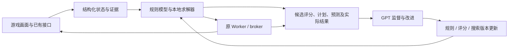

# 货币战争求解器：职责纠正、成熟实现调查与跨电脑交接

观察日期：2026-10-11，Asia/Shanghai。接收方是正在另一台电脑上操作星铁的 Codex/开发者；本机没有接入其游戏或账号。本文记录已验证事实与下一步实现要求，不能作为接管另一台电脑当前会话的凭据。

## 先读：用户要的产品与当前缺口

用户从一开始要的就是类似 CombatSolver 的**本地求解器**：程序持续读取状态、比较决策、生成并执行计划；GPT 监控求解器，发现不合理行为后改进规则、评分、搜索或状态读取。用户已多次要求调查已有游戏自动化实现。

此前推进把职责放错了：识图脚本和 MCP 适配承担观察/提交，但局内决策仍由对话中的 GPT 逐次完成。MCP 首版通过并不代表求解器完成；守卫、日志和点击批处理也不能替代决策引擎。下一阶段应以**独立决策和持续执行的本地求解器**为主线，不能继续把“GPT 看图逐次指挥”当最终产品。

这次调查已经找到可借鉴的公开实现。此前没有把成熟实现调查做成有源码依据、能力对照和实测结论的交付，是本轮需要纠正的工作方法。

## 预期职责

| 层 | 负责 | 正常运行时的边界 |
|---|---|---|
| 观察层 | 截图/OCR/模板或已有合法状态接口；输出结构化状态、来源、快照、未知字段 | 解释画面，不替求解器挑购买对象或决定刷新 |
| 规则与状态模型 | 合法动作、已知费用、金币/人口/装备/羁绊约束及可验证的状态转移 | 未暴露的商店结果和战斗随机性须显式建模为未知或分布，不能编造成已知 |
| 本地求解器 | 根据目标生成候选，预测可建模的后果，评分/搜索，选择计划及停止条件 | 无需 GPT 对每个动作批准；须能在没有当前聊天逐次回复的情况下决策 |
| 原 Worker / broker | 发布计划、校验原身份/快照/阶段/预算、重定位、执行、核对后置状态与实际效果 | 沿用唯一执行器；求解器不新增旁路输入，不把提交受理当成功 |
| MCP / CLI | 暴露状态、求解器运行状态、计划/解释、停止等能力 | MCP 是调用接口，不拥有游戏规则，也不会自动提供原生 API |
| GPT 监督与研发 | 检查轨迹和反例，研究已有实现，修改求解器，回放评估后发布改进 | 常规局内动作由求解器决定；只有明确异常、能力缺口或策略变更才升级到 GPT |



## 公开实现调查：不要把 README 宣传当已验证能力

以下为 2026-10-11 查询结果。除 CombatSolver 的有限本机实测外，没有在本机执行这些项目，也没有测量它们在星铁中的胜率。它们是具体参考，不应统称已经证明可用的货币战争求解器。

| 项目与固定版本 | 查到的事实 | 对本项目的用处与限制 |
|---|---|---|
| [CombatSolver](https://github.com/Torch1230/CombatSolver/tree/v0.50.1)，发布版 0.50.1 | 捕获根状态，独立分支推进卡牌/牌堆/RNG/敌人 AI，预算内跨回合搜索；原生执行，预测一致时复用路线。已在本机运行。 | 直接参考“本地求解 → 执行 → 核对 → 重算”的闭环。游戏特定规则不可直接移植；并非全局最优保证。 |
| [sts2core](https://github.com/lain-wood/sts2core/tree/3b2d969d025b9e64bc96b9a15928bd2a0d824bf2) | README 与目录区分 L1 规则内核、L2 局内求解、L3 构筑评估；列出真实轨迹对拍及已知模拟误差。适配 v0.107.1。 | 参考纯状态转移和“预测/实测逐字段对拍”。作者明确披露洗牌 RNG 未暴露等限制，不能把未知未来当确定状态。未实测。 |
| [ClawTheSpire](https://github.com/dbyrne/ClawTheSpire/tree/74584cb4b42e9ea7548412e1a142f95a32dcfa45) | 当前 [runner.py](https://github.com/dbyrne/ClawTheSpire/blob/74584cb4b42e9ea7548412e1a142f95a32dcfa45/sts2-solver/src/sts2_solver/runner.py) 有本地对局循环、MCTS 调用和确定性顾问；有日志及训练相关代码。 | 参考持续控制循环、搜索与执行分离。README 仍描述 DFS/LLM 和 solve_combat/advise_strategy，但当前 [mcp_server.py](https://github.com/dbyrne/ClawTheSpire/blob/74584cb4b42e9ea7548412e1a142f95a32dcfa45/sts2-solver/src/sts2_solver/mcp_server.py) 只注册 solver_health；文档与代码有差异，不能照宣传接口直接集成。未实测。 |
| [StarRailAssistant](https://starrailassistant.top/) / [源码](https://github.com/EveGlowLuna/StarRailAssistant) | 官方文档列出货币战争全程/接管流程、自定义阵容与策略，及 [MCP 接口](https://starrailassistant.top/server/mcp/)。[自定义攻略](https://starrailassistant.top/en/getting-started/advance/) 用 JSON 表达目标阵容、保留金币、升级要求和事件选择。 | 与货币战争最直接相关，优先审查其状态机、识别、购买/升级/刷新/站位流程。当前证据属于官方文档，尚未完整审阅其实现或测试；不能宣称已有原生星铁状态 API 或精确战斗搜索。 |
| [autoSpire](https://github.com/LightEnding/autoSpire)，0.1.5 | 游戏模组读取状态并执行原生动作，Python MCP 转接；本机 SDK 和当前对话原生 MCP 均调用成功。 | 证明游戏工具接口可行；本次由 GPT 决定其动作，不能作为本地求解器的证明。当前输出仅有战斗牌堆数量，不能与 CombatSolver 的完整模拟状态等同。 |

后续研究交付要求：固定 commit/版本，阅读真实入口，写清状态来源、决策由谁完成、是否本地循环、未知状态处理、可复用模块、依赖与授权许可、复现方式和未验证项。缺少这些信息时标注未核实；“搜不到”与“未完整搜索”也必须区分。

## 尖塔实测证据

初始 Steam 稳定版为 v0.107.1；用户授权检查 beta 后，经 Steam public-beta 更新到 v0.111.0、build 24724944。CombatSolver 0.50.1 要求 v0.111.0 与 RitsuLib >= 0.6.0；安装 RitsuLib 0.6.7。该差异是发行分支差异，不是用户没有更新稳定版。

- autoSpire 首场 MCP：真实 SDK initialize/list_tools/call_tool，完成首场史莱姆战斗并回到地图，战后 80/80 HP；这是 GPT 决策的接口演示。
- 求解器第一场缩小甲虫：搜索记录 0.7548018 秒，首路线发布约 789.8 毫秒，预测三回合胜利、损失 2 HP、无药水。根状态含牌堆及 RNG，后续回合状态可复用。自动执行前两回合后，在预计击杀的回合按配置暂停；后来进入奖励页，最后回合来源未完整确认。这场不记为完整无人干预验证。
- 求解器第二场毛绒伏地虫：搜索记录 0.1651399 秒，预测三回合胜利、损失 4 HP。前两回合由模组执行；暂停后在模组设置关闭“预计结束战斗时暂停”，重新开启全自动，由模组完成最后回合。战后奖励页 80/80 HP，药水未消耗。本对话没有发送战斗 play_card/multi_play/end_turn/use_potion。
- 暂停的源码原因是 [SolverController.cs](https://github.com/Torch1230/CombatSolver/blob/v0.50.1/src/Runtime/SolverController.cs#L2775)：stopFullAutoOnCombatEnd 在预测本回合结束战斗时停手，不是战后才停。
- 本次仅是低难度简单战斗；第二场中途调整一次开关，没有另做无设置干预整场或整局通关。搜索耗时不是对局总耗时；画面显示的 191 条世界线也不等于穷尽所有路线。

可跨电脑读取的证据：[搜索摘要](SOLVER_EVIDENCE.json)、[自动执行与暂停面板](solver-combat.png)、[第二场战后画面](solver-second-victory.png)。全文记录和原始路由暂存本机 `D:/Codex/Projects/sts2-mcp-demo`，本交接只发布不含会话凭据的摘要与窗口截图。

## 仓库当前状态：已有接口适配，尚无货币战争求解器

本分支 `codex/currency-wars-mcp` 从主线 `4cf23830e7832ee68b4ef40ba688b006ee3064fc` 建立。实现提交 `e65bd21111c348fef144a163493189258c9e1475` 提供 get_state/get_task_status/submit_plan/pause/run_economy_plan 五个 stdio 工具。

真实 SDK 初始化与工具调用、历史商店图状态读取、无身份拒绝和 7 项相关边界检查通过。独立审查通过仅覆盖该离线首版，见 [MCP 核验记录](../../mcp/VERIFICATION.md) 与 [独立审阅](MCP_REVIEW.md)。历史图可读金币 68；玩家等级/人口/经验等不足时 unknown。没有在星铁做 live 输入、部署候选或测试扣款效果。

main 的 run_economy_plan 返回 unsupported。PR16 精确候选 `5938648de4cfd4b5cd3cd723898abb3c2f806a48` 有原生有界经济事务；适配只在显式开启且七项源码指纹一致时提交，仍不是新求解器。接收方的新分支可能已有更晚实现，必须按其实际代码重新核实，不为通过旧指纹而回退生产分支。

另已读到远端 `root-live-review-20261008` 的 `2bf13da` 交接：[ROOT_PRO_NEXT_TASK.md](https://github.com/gkcc/Currency-Wars-Automation/blob/2bf13da/handoff/2026-10-08/ROOT_PRO_NEXT_TASK.md)。其中报告完整大局成绩和临时本地商店批处理，但仍指出每节点分钟级决策等待，要求调研已有实践。该记录是另一分支的报告，不是本机亲自完成的对局，也不证明主线已有独立决策引擎。

## 另一台电脑下一步：先做能独立决策的最小求解器

1. **确认实际运行基线。**记录该电脑工作分支/HEAD、部署版本与未提交内容，读取现有完整大局证据。对局运行中只读本交接，不切分支、重装或接管另一个控制器。先列出观察、决策、执行分别由谁完成，以及每阶段耗时；宿主间隙不能直接叫模型思考时间。
2. **优先核对现有实现。**审查 SRA 的货币战争任务源码及当前仓库的有界经济候选；用实际对局事实比较可用状态字段与控制流程。优先复用成熟循环，而不是重新造截图/点击框架；是否复用代码须核对许可证、依赖和当前部署兼容性。
3. **实现本地决策模块。**第一段目标可限定在准备阶段经济与阵容安排。观察层给出真实可用状态；规则层枚举合法候选；求解器比较购买顺序、保留金币、升级、合成及阵容/槽位选择。给每个候选明确的约束、评分、预测变化与停止条件。只执行 GPT 已经填好的购买清单属于执行器能力，不算求解器独立决策。
4. **按真实可知范围建模。**经济变化和容量约束先做可靠状态转移；未知刷新结果不预知，用有限预算和看到新商店后重算。不能精确模拟战斗时，先明确使用启发式阵容评分，并记录假设与置信度；不要把完整战斗模拟器的缺失变成停止一切本地决策的理由。重要决策所需字段缺失时才请求补读/退出；无关字段 unknown 不应阻断整个循环。
5. **接上自主闭环。**本地循环完成 observe → solve → 原 broker 执行 → 核验效果 → observe/replan。GPT 不在每次购买/刷新的必经路径上。MCP 可暴露运行、状态、计划解释与停止等能力；这些是下一阶段设计，当前五工具没有自主求解入口。
6. **GPT 做监督与改进。**记录状态、候选、被选方案、评分、预测结果、真实后状态、规则/求解器版本。发现乱买、无收益刷新、漏领奖、坐标失效或条件满足却停止后，定位到观察、规则、评分、搜索或执行；保留反例，修改对应模块，再回放比较并部署。一次对话人工纠正该步不算已修复求解器。是否持续监督、部署或实机执行，沿用接收方用户已经给出的授权。

## 验收条件

- 在已支持的准备阶段，关闭 GPT 逐次决策后，本地求解器能独立生成并执行多轮合法决策，不依赖人/模型给出每张购买名单。
- 同状态、同策略/规则版本的决策可复现；有候选对照、选择理由和明确停止原因。简单脚本能跑不能替代决策质量证明。
- 每步核对金币、槽位、物品等真实后置变化；提交受理、输入回执与业务成功分开报告。
- 用真实历史状态对拍规则预测和实际结果；先覆盖支持的规则，复杂战斗未建模的部分明确列出。优先用已有检查和最小行为验证，显著风险才加持久反例。
- GPT 能根据轨迹发现至少一项不合理决策，修改求解器后在相同反例上改善；改进应留在程序中，而非由 GPT 下次继续代打。
- 量化每准备阶段的模型调用次数、观察/求解/执行/等待耗时及成绩，和当前逐次决策基线做同条件比较。尚未设置或测量的阈值保持未验证，不许编造提速倍数。

## 拉取与阅读

已有 clone 可在当前运行结束后评估代码；仅阅读文档时无需切换当前分支：

```powershell
git fetch origin codex/currency-wars-mcp
git show FETCH_HEAD:handoff/2026-10-11/SOLVER_HANDOFF.md
```

发布在 `codex/currency-wars-mcp` 分支，合入 main 前，普通 `git pull origin main` 不会得到该分支内容。阅读交接不代表批准安装 SDK、部署候选或修改正在运行的游戏环境。
